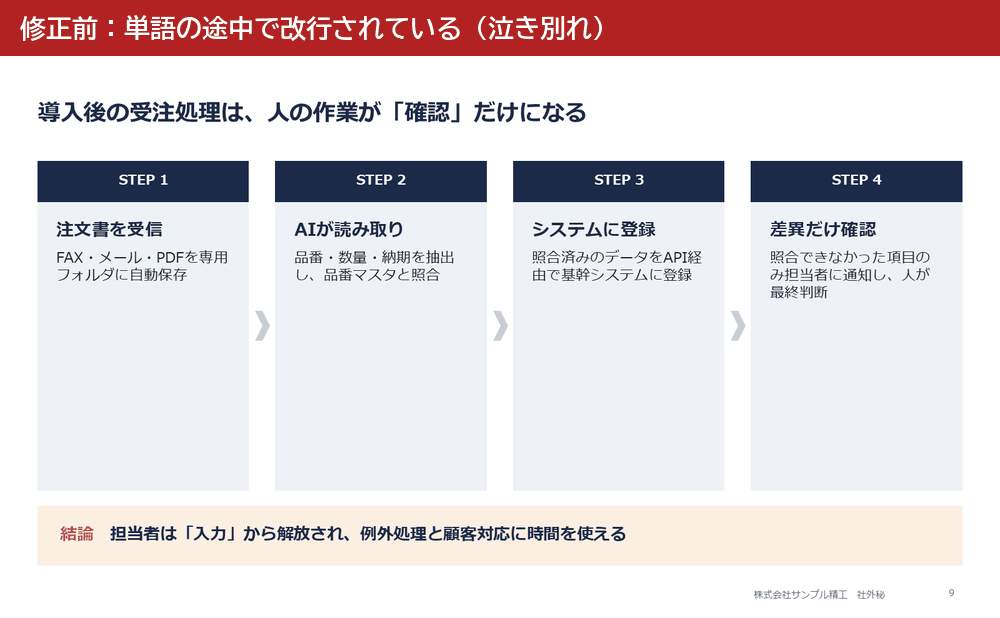
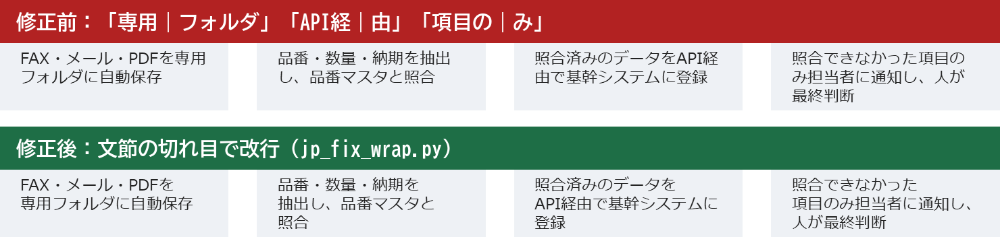
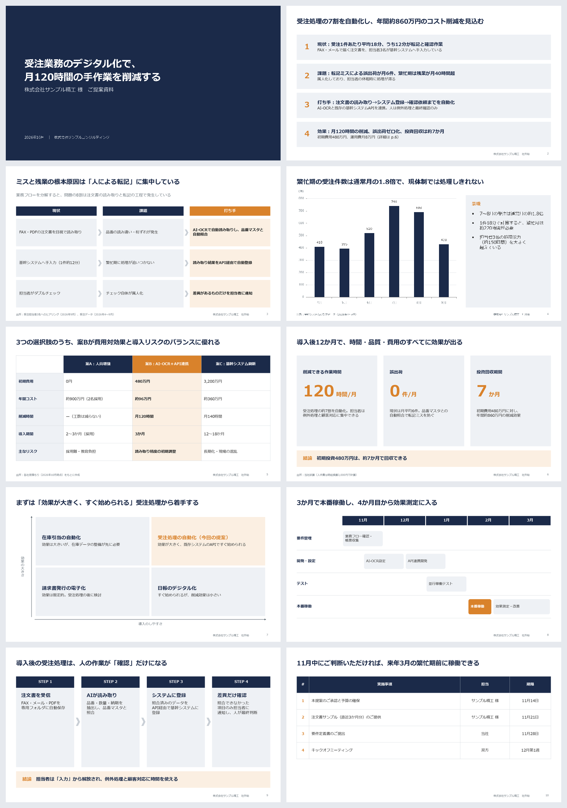

# japanese-business-slides

**日本語のパワポ資料を「そのまま社外に出せる」品質で作る Claude スキル。**
PowerPoint 実機の改行位置を調べて、単語の途中で切れる「泣き別れ」を自動で直します。



AI にスライドを作らせると、日本語は「専用｜フォルダ」「API経｜由」のように単語の途中で改行されがちです。PowerPoint には日本語を文節で折り返す機能がないため、人が1か所ずつ Shift+Enter で直すしかありませんでした。

このスキルは、

1. **PowerPoint 本体に実際にレイアウトさせて**、どこで改行されたかを取得し
2. **BudouX**（Google の日本語文節分割）で、その改行が単語の途中かどうかを判定し
3. **文節の切れ目に行内改行を入れて**、もう一度 PowerPoint で確認する

までを自動で行います。このスキルで作った資料だけでなく、**手元にある既存の .pptx にも使えます。**

解説記事：
- note（使い方の紹介）：[AIが作ったパワポの「泣き別れ」を自動で直す。Claude Code用スキルを無料公開しました](https://note.com/glad_moose4636/n/n752279cadf64)
- Zenn（実装の解説）：[PowerPointの日本語「泣き別れ」を、PowerPoint自身に改行位置を聞いて自動で直す](https://zenn.dev/haihan19955/articles/93a10be81996a8)




## できること

| | |
|---|---|
| 📐 **コンサル型の構成** | タイトル＝結論（メッセージライン）、エグゼクティブサマリー、現状→課題→打ち手、出所・ページ番号の作法を Claude に守らせる |
| 🧩 **日本のビジネス資料の型 11 種** | 表紙・サマリー・課題整理・グラフ＋示唆・比較表・2×2・KPI・プロセス・ロードマップ・ネクストステップ・章扉 |
| ✂️ **泣き別れの自動修正** | `jp_fix_wrap.py`：PowerPoint 実機の改行位置をもとに、文節の切れ目で改行し直す |
| 🔍 **日本語資料のチェッカー** | `jp_lint.py`：はみ出し・泣き別れ・数字と単位の分離・テーマ名だけのタイトル・欧文フォント・文体の混在・表記ゆれなど 15 項目 |
| 🖼️ **実機レンダリング** | `render_slides.ps1`：PowerPoint 本体で PNG 化して目視確認（LibreOffice と違い、本番と同じ見た目） |

### サンプル（examples/sample.pptx）

架空の中小メーカー向け「受注業務DX」提案資料 10 枚。Claude がこのスキルで作成し、チェッカーで error 0 件にしたものです。



## インストール

### Claude Code

```bash
git clone https://github.com/haihan19955/jp-business-slides.git
# スキル本体をユーザーのスキルフォルダへ
cp -r jp-business-slides/skills/japanese-business-slides ~/.claude/skills/
```

Windows（PowerShell）の場合:

```powershell
git clone https://github.com/haihan19955/jp-business-slides.git
Copy-Item -Recurse jp-business-slides\skills\japanese-business-slides "$env:USERPROFILE\.claude\skills\"
```

### 依存パッケージ

```bash
npm install pptxgenjs
pip install python-pptx budoux
```

泣き別れの検出・自動修正と画像化には **Windows + Microsoft PowerPoint** が必要です（PowerPoint 本体に改行位置を計算させるため）。Mac / Linux では文言・フォント・構成のチェックだけ動きます。

## 使い方

Claude Code にふつうに頼むだけです。

```
来週の経営会議用に、受注業務のデジタル化の提案資料を10枚くらいで作って。
決裁してもらうのが目的。数字は添付のExcelを使って。
```

```
この提案書.pptx の泣き別れとはみ出しをチェックして直して。
```

スクリプトを直接使うこともできます。

```bash
# 既存の資料の泣き別れを自動修正（元ファイルは上書きしない）
python skills/japanese-business-slides/scripts/jp_fix_wrap.py 提案書.pptx -o 提案書_修正版.pptx

# チェック（PowerPoint の実際の改行位置を使う）
powershell -ExecutionPolicy Bypass -File skills/japanese-business-slides/scripts/export_layout.ps1 -Pptx 提案書_修正版.pptx -Out layout.json
python skills/japanese-business-slides/scripts/jp_lint.py 提案書_修正版.pptx --layout layout.json
```

出力例:

```
== スライド 3 ==
 ✖ L2 [Text 16] 単語の途中で改行されている（泣き別れ）: 「…、品番マスタと自｜動照合…」
     → 「自動照合」の前で改行する（jp_fix_wrap.py で自動修正できる）
== スライド 6 ==
 ✖ L4 [Text 13] 数字と単位が別の行に分かれている: 「…、年間約860万｜円の削減効果…」
     → 「年間約860万円の」を同じ行に収める（jp_fix_wrap.py で自動修正できる）
```

別の資料（python-pptx で作った一般的な .pptx）では、タイトルの書き方も指摘します:

```
 △ T3 タイトルがテーマ名になっている（結論が書かれていない）: 受注業務の現状について。
     → 「〜について」ではなく「〜なので、〜すべき」のように、このスライドの結論を書く
```

## チェック項目

| コード | 内容 |
|---|---|
| L1 | 文字が枠からはみ出している |
| L2 | 単語の途中で改行されている（泣き別れ） |
| L3 | 最終行が1〜2文字だけ |
| L4 | 数字と単位が別の行に分かれている |
| T1–T4 | タイトルが空・句点つき・テーマ名だけ・長すぎる |
| F1–F3 | 日本語に欧文フォント・本文12pt未満・書体の混在 |
| S1 | グラフに出所がない |
| W1–W4 | です・ます／だ・であるの混在・全角英数字・表記ゆれ・半角カナ |

## 構成

```
skills/japanese-business-slides/
├── SKILL.md              # Claude への指示（構成・書き方・作成・検証の手順）
└── scripts/
    ├── jpdeck.js         # 日本のビジネス資料の型（pptxgenjs）
    ├── jp_lint.py        # チェッカー
    ├── jp_fix_wrap.py    # 泣き別れの自動修正
    ├── export_layout.ps1 # PowerPoint 実機の改行位置を JSON に書き出す
    └── render_slides.ps1 # PowerPoint 実機で PNG に書き出す
examples/sample.js        # サンプル資料の生成スクリプト
```

## 制限

- 泣き別れの判定は BudouX の文節区切りに基づきます。固有名詞や専門用語で区切りが不自然な場合があります。
- 1つの文節が1行より長い場合は、「・」「、」の後ろで切るか、言い回しの変更を提案します。
- グラフ内の文字（軸ラベルなど）はチェック対象外です。

## このスキルについて

このリポジトリのコード・サンプル資料・README は、Claude（Anthropic の AI）が設計・実装・テストしました。不具合や「この型がほしい」という要望は Issue へどうぞ。

## ライセンス

MIT
